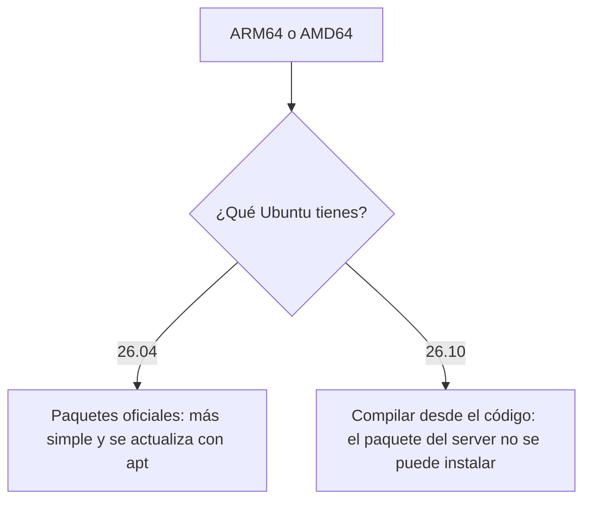
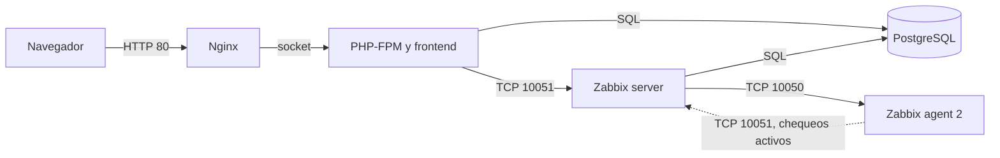
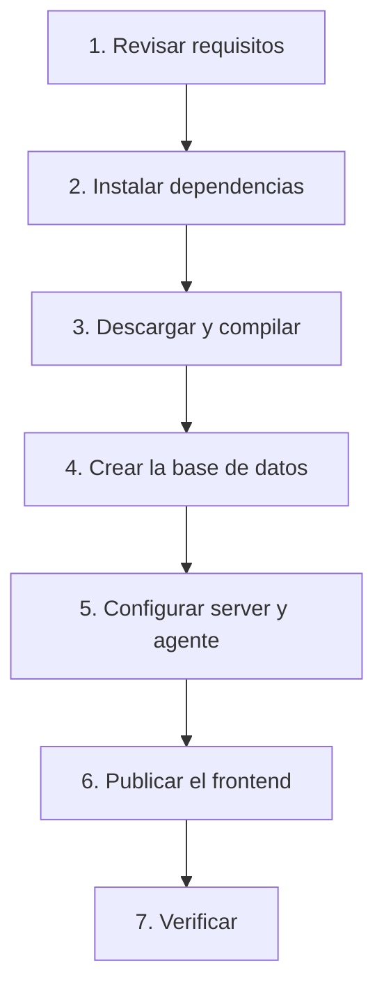

# Zabbix 8.0.0rc3 en Ubuntu: ARM64 y AMD64


Guía paso a paso para instalar **Zabbix 8.0.0rc3** en servidores **ARM64** y **AMD64/x64**. La ruta principal compila desde el código oficial; los comandos y las salidas provienen de una instalación real en ARM64.

> [!WARNING]
> **RC3 es una versión candidata.** Úsala para probar y aprender, no en producción.

> [!CAUTION]
> **Vulnerabilidades críticas de PHP (octubre de 2026):** actualiza PHP y aplica la mitigación antes de exponer el server. [Revisa aquí si te afecta](docs/seguridad-php.md).

## ¿Qué camino te toca?

Averigua tu arquitectura:

```bash
uname -m
```

| Resultado | Arquitectura | Nombres habituales |
|---|---|---|
| `x86_64` | **AMD64** | x64, Intel/AMD de 64 bits |
| `aarch64` | **ARM64** | AArch64, Apple Silicon en VM, Graviton |

**El camino depende de tu versión de Ubuntu, no de la arquitectura:**



| Ubuntu | Método | Empieza aquí |
|---|---|---|
| **26.04** | Paquetes oficiales | [Alternativa con paquetes](docs/alternativa-paquetes-26.04.md) |
| **26.10** | Compilar desde el código | [Paso 1](docs/01-requisitos.md) |

También puedes dejar que lo revise un script, que no cambia nada en tu server:

```bash
git clone https://github.com/SimonLexRS/Zabbix-8-rc3-Instalacion.git
cd Zabbix-8-rc3-Instalacion
scripts/preflight.sh
```

## ¿Qué se probó en cada arquitectura?

| Comprobación | ARM64 | AMD64/x64 |
|---|---|---|
| Paquetes del paso 2 disponibles en Ubuntu 26.10 | ✅ | ✅ |
| Compilación e instalación completas | ✅ Ejecutadas | ⚠️ No ejecutadas |
| `scripts/verificar.sh` | ✅ Ejecutado | ⚠️ No ejecutado |
| Paquetes oficiales RC3 publicados para 26.04 | ✅ | ✅ |
| Instalación con paquetes en 26.04 | ⚠️ No ejecutada | ⚠️ No ejecutada |

> [!NOTE]
> Los comandos de la guía son los mismos en AMD64: no usan rutas ni opciones propias de una arquitectura. Aun así, la instalación real se hizo solo en ARM64. En AMD64, confirma cada resultado con `scripts/verificar.sh`.

**¿Por qué no sirven los paquetes en 26.10?** El paquete `zabbix-server-pgsql` necesita la librería `libsnmp40t64`, pero Ubuntu 26.10 trae `libsnmp45`. [Ver el detalle](docs/problemas-y-soluciones.md#1-el-paquete-del-server-no-se-puede-instalar).

## Qué vas a instalar



| Pieza | Para qué sirve | Versión |
|---|---|---|
| **Zabbix server** | Recoge los datos y evalúa las alertas | 8.0.0rc3 |
| **Zabbix agent 2** | Mide el estado de este server | 8.0.0rc3 |
| **Frontend** | La interfaz web | 8.0.0rc3 |
| **PostgreSQL** | Guarda configuración e historial | 18.6 |
| **Nginx y PHP-FPM** | Sirven la interfaz web | 1.30.4 y 8.5.9 |

## El camino completo



| Paso | Qué harás | Resultado esperado |
|---|---|---|
| [1. Requisitos](docs/01-requisitos.md) | Revisar versiones, puertos y memoria | Sabes si tu server sirve |
| [2. Dependencias](docs/02-dependencias.md) | Instalar compiladores, PostgreSQL, Nginx y PHP | Herramientas listas |
| [3. Compilación](docs/03-compilacion.md) | Descargar, verificar y compilar | `zabbix_server -V` muestra `8.0.0rc3` |
| [4. Base de datos](docs/04-base-de-datos.md) | Crear la base e importar datos | 230 tablas creadas |
| [5. Servicios](docs/05-servicios.md) | Configurar y arrancar con systemd | Server y agente activos |
| [6. Frontend](docs/06-frontend.md) | Publicar la interfaz web | Página de login visible |
| [7. Verificación](docs/07-verificacion.md) | Comprobar todo de punta a punta | El host recibe datos |

**¿Algo falló?** Ve a [Problemas y soluciones](docs/problemas-y-soluciones.md). **¿Quieres revisar todo de una vez?** Ejecuta [`scripts/verificar.sh`](scripts/verificar.sh). **Seguridad:** [Vulnerabilidades de PHP](docs/seguridad-php.md).

## Entorno de la instalación de referencia

| Elemento | Valor |
|---|---|
| Sistema | Ubuntu 26.10 (`stonking`), kernel 7.3, ARM64 (`aarch64`) |
| CPU y memoria | 6 vCPU, 3.3 GiB de RAM, 3.8 GiB de swap |
| Disco | 25 GB |

## Antes de usarla en serio

| Tema | Situación | Qué hacer |
|---|---|---|
| Contraseña | Zabbix inicia con `Admin` / `zabbix` | Cámbiala al entrar por primera vez |
| PHP | Hay vulnerabilidades críticas recientes | Sigue [Seguridad de PHP](docs/seguridad-php.md) |
| Actualizaciones | Nada de Zabbix se actualiza con `apt` | Para la 8.0.0 final, vuelve a compilar |
| Capacidad | Zabbix da 2 CPU y 8 GiB de RAM como ejemplo para 1 000 métricas | Trata 3.3 GiB como laboratorio |
| Cifrado | El frontend usa HTTP en el puerto 80 | Agrega TLS si sale de una red de pruebas |
| TimescaleDB | Sin paquete para PostgreSQL 18 en este Ubuntu | No se instaló |

## Archivos de configuración

| Archivo | Destino |
|---|---|
| [`config/zabbix-server.service`](config/zabbix-server.service) | `/etc/systemd/system/` |
| [`config/zabbix-agent2.service`](config/zabbix-agent2.service) | `/etc/systemd/system/` |
| [`config/nginx-zabbix.conf`](config/nginx-zabbix.conf) | `/etc/nginx/sites-available/zabbix` |
| [`config/php-fpm-zabbix.conf`](config/php-fpm-zabbix.conf) | `/etc/php/8.5/fpm/pool.d/zabbix.conf` |
| [`config/postgresql-zabbix.conf`](config/postgresql-zabbix.conf) | `/etc/postgresql/18/main/conf.d/zabbix.conf` |

## Referencias oficiales

- [Requisitos de Zabbix 8.0](https://www.zabbix.com/documentation/8.0/en/manual/installation/requirements)
- [Instalación desde fuentes](https://www.zabbix.com/documentation/8.0/en/manual/installation/install)
- [Creación de la base de datos](https://www.zabbix.com/documentation/8.0/en/manual/appendix/install/db_scripts)
- [Descargas de release candidates](https://cdn.zabbix.com/zabbix/sources/release_candidates/8.0/)
