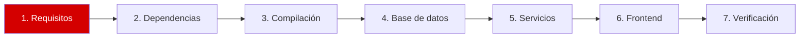

# Paso 1 de 7: Requisitos

**Objetivo:** confirmar que tu server es compatible antes de instalar nada.



## Revisa tu server

```bash
scripts/preflight.sh
```

> [!TIP]
> Si aún no descargaste este repositorio, usa `uname -m`, `nproc`, `free -h` y `df -h /`.

## Arquitectura: qué cambia y qué no

| | ARM64 (`aarch64`) | AMD64/x64 (`x86_64`) |
|---|---|---|
| Comandos de esta guía | Iguales | Iguales |
| Archivo de código fuente | El mismo | El mismo |
| Archivos de `config/` | Los mismos | Los mismos |
| Programas compilados | Solo para ARM64 | Solo para AMD64 |
| `go version` termina en | `linux/arm64` | `linux/amd64` |

> [!IMPORTANT]
> Compila en la misma arquitectura donde vas a ejecutar: un binario de una no funciona en la otra. [Ver el error](problemas-y-soluciones.md#15-exec-format-error).

En la instalación de referencia (ARM64):

| Dato | Valor |
|---|---|
| Sistema | Ubuntu 26.10 |
| Arquitectura | `aarch64` |
| CPU | 6 vCPU |
| RAM | 3.3 GiB |
| Disco libre | 16 GB |

> [!NOTE]
> Zabbix da como ejemplo 2 CPU y 8 GiB de RAM para 1 000 métricas. Con menos memoria funciona para un laboratorio, pero no para esa carga.

## Versiones compatibles

| Software | Admite RC3 | Instalado | ¿Sirve? |
|---|---|---|---|
| PostgreSQL | 13.0 a 18.x (soporte oficial desde 15.0) | 18.6 | ✅ |
| PHP | 8.2.0 a 8.5.x | 8.5.9 | ✅ |
| Nginx | 1.20 o superior | 1.30.4 | ✅ |

## Puertos

| Puerto | Servicio | Quién debe llegar |
|---|---|---|
| **80/tcp** | Interfaz web | Tu navegador |
| **10051/tcp** | Zabbix server | Agentes en otros equipos |
| **10050/tcp** | Zabbix agent 2 | El Zabbix server |
| **5432/tcp** | PostgreSQL | Solo el propio server (`127.0.0.1`) |

Comprueba que estén libres. Si este comando no muestra nada, está todo bien:

```bash
ss -tln | grep -E ':(80|5432|10050|10051) '
```

> [!TIP]
> `ufw` estaba inactivo en este server, así que no se agregaron reglas. Si lo activas, abre primero el puerto 22 para no perder el acceso por SSH, y luego el 80 y el 10051.

---

➡️ Siguiente: [Paso 2: Dependencias](02-dependencias.md)
