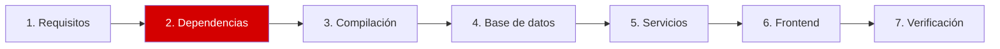

# Paso 2 de 7: Dependencias

**Objetivo:** instalar lo necesario para compilar y ejecutar Zabbix.



## Instalar

```bash
sudo apt-get update
sudo DEBIAN_FRONTEND=noninteractive apt-get install -y \
  build-essential pkg-config golang-go \
  libpq-dev libsnmp-dev libcurl4-openssl-dev libxml2-dev libevent-dev \
  libpcre2-dev libssl-dev libssh-dev libopenipmi-dev unixodbc-dev \
  libldap-dev libc-ares-dev fping \
  postgresql nginx php-fpm php-pgsql php-gd php-bcmath php-mbstring \
  php-xml php-ldap php-curl fonts-dejavu-core
```

| Grupo | Paquetes | Para qué |
|---|---|---|
| Compilación | `build-essential`, `pkg-config`, `golang-go` | Compilar el server (C) y el agente 2 (Go) |
| Librerías | Paquetes `lib*-dev` | SNMP, HTTP, TLS, SSH, IPMI, LDAP y más |
| Red | `fping` | Chequeos de ping |
| Servicios | `postgresql`, `nginx`, `php-*` | Base de datos e interfaz web |

## ✅ Qué deberías ver

```bash
go version; psql --version; nginx -v; php -v | head -1
systemctl is-active postgresql nginx php8.5-fpm
```

Salida en ARM64. En AMD64, `go version` termina en `linux/amd64`:

```text
go version go1.27.1 linux/arm64
psql (PostgreSQL) 18.6 (Ubuntu 18.6-3build2)
nginx version: nginx/1.30.4 (Ubuntu)
PHP 8.5.9 (cli) (built: Oct 19 2026 12:22:12) (NTS)
active
active
active
```

> [!IMPORTANT]
> **Comprueba que PHP tenga el parche de seguridad.** `php -v` no basta: mira la versión del paquete.
>
> ```bash
> dpkg-query -W -f='${Version}\n' php8.5-fpm
> ```
>
> En Ubuntu 26.10 debe ser `8.5.9-0ubuntu2.1` o superior. [Ver por qué](seguridad-php.md).

> [!NOTE]
> Las versiones pueden ser más recientes si Ubuntu publicó actualizaciones. Si cambia la versión de PHP, ajusta `8.5` en las rutas y comandos de esta guía.

---

⬅️ [Paso 1](01-requisitos.md) | ➡️ Siguiente: [Paso 3: Compilación](03-compilacion.md)
