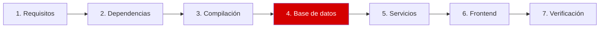

# Paso 4 de 7: Base de datos

**Objetivo:** crear la base donde Zabbix guarda su configuración y su historial.



## 4.1 Crear contraseña, usuario y base

La contraseña se genera al azar y queda en un archivo que solo root puede leer:

```bash
sudo install -d -o root -g root -m 700 /root/.zabbix
PW=$(openssl rand -base64 33 | tr -d '/+=' | cut -c1-32)
printf '%s' "$PW" | sudo install -m 600 /dev/stdin /root/.zabbix/db_password

printf "CREATE ROLE zabbix LOGIN PASSWORD '%s';\n" "$PW" \
  | sudo -u postgres psql -q -v ON_ERROR_STOP=1
sudo -u postgres createdb -O zabbix -E Unicode -T template0 zabbix
```

## 4.2 Importar las tablas y los datos iniciales


```bash
cd ~/zabbix-8.0.0rc3/database/postgresql
for f in schema images data; do
  cat "$f.sql" | sudo -u zabbix psql -q -v ON_ERROR_STOP=1 -d zabbix
done
```

> [!IMPORTANT]
> Usa `cat archivo | psql`, como aquí. Con `psql -f` puede salir `Permission denied`. [Ver por qué](problemas-y-soluciones.md#2-permission-denied-al-importar-el-esquema).

## 4.3 Ajustar PostgreSQL a la memoria del server

[`postgresql-zabbix.conf`](../config/postgresql-zabbix.conf) está pensado para 3.3 GiB de RAM. Si tienes otra cantidad, adapta los valores.

```bash
sudo install -m 644 ~/Zabbix-8-rc3-Instalacion/config/postgresql-zabbix.conf \
  /etc/postgresql/18/main/conf.d/zabbix.conf
sudo systemctl restart postgresql
```

## ✅ Qué deberías ver

```bash
sudo -u zabbix psql -d zabbix -Atc \
  "select count(*) from information_schema.tables where table_schema='public'" \
  -c "select mandatory, optional from dbversion"
```

```text
230
7050209|7050209
```

| Valor | Significado |
|---|---|
| `230` | Tablas creadas |
| `7050209` | Versión del esquema, la que espera el RC3 |

---

⬅️ [Paso 3](03-compilacion.md) | ➡️ Siguiente: [Paso 5: Servicios](05-servicios.md)
