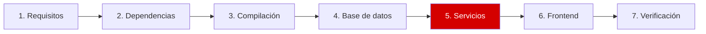

# Paso 5 de 7: Server, agente y systemd

**Objetivo:** configurar el server y el agente, y hacer que arranquen solos con el sistema.



Al compilar no se crean servicios de systemd, y logs, PID y sockets apuntan a `/tmp`. Aquí se corrige eso.

## 5.1 Configurar el server

| Parámetro | Valor | Por qué |
|---|---|---|
| `LogFile` | `/var/log/zabbix/zabbix_server.log` | Conservar los logs fuera de `/tmp` |
| `PidFile` | `/run/zabbix-server/zabbix_server.pid` | Carpeta creada por systemd |
| `SocketDir` | `/run/zabbix-server` | Carpeta creada por systemd |
| `DBHost` | `localhost` | Conexión con contraseña |
| `DBPassword` | La generada en el paso 4 | Acceso a la base |
| `FpingLocation` | `/usr/bin/fping` | Ruta real en Ubuntu |
| `CacheSize` | `64M` | Más que los 32M por defecto |

```bash
S=/etc/zabbix/zabbix_server.conf
sudo sed -i -E \
  -e 's|^#? *LogFile=.*|LogFile=/var/log/zabbix/zabbix_server.log|' \
  -e 's|^#? *PidFile=.*|PidFile=/run/zabbix-server/zabbix_server.pid|' \
  -e 's|^#? *SocketDir=.*|SocketDir=/run/zabbix-server|' \
  -e 's|^#? *DBHost=.*|DBHost=localhost|' \
  -e 's|^#? *FpingLocation=.*|FpingLocation=/usr/bin/fping|' \
  -e 's|^#? *CacheSize=.*|CacheSize=64M|' "$S"

PW=$(sudo cat /root/.zabbix/db_password)
sudo sed -i -E "s|^#? *DBPassword=.*|DBPassword=$PW|" "$S"

sudo chown root:zabbix "$S"
sudo chmod 640 "$S"
```

> [!WARNING]
> Este archivo contiene la contraseña. Por eso el `chmod 640`, y por eso no debes subirlo a un repositorio.

## 5.2 Configurar el agente

```bash
A=/etc/zabbix/zabbix_agent2.conf
sudo sed -i -E \
  -e 's|^#? *LogFile=.*|LogFile=/var/log/zabbix/zabbix_agent2.log|' \
  -e 's|^#? *PidFile=.*|PidFile=/run/zabbix-agent2/zabbix_agent2.pid|' \
  -e 's|^#? *ControlSocket=.*|ControlSocket=/run/zabbix-agent2/agent.sock|' "$A"
```

`Server=127.0.0.1`, `ServerActive=127.0.0.1` y `Hostname=Zabbix server` ya vienen así y coinciden con el host predefinido de Zabbix.

## 5.3 Crear los servicios y arrancarlos

```bash
cd ~/Zabbix-8-rc3-Instalacion
sudo install -m 644 config/zabbix-server.service config/zabbix-agent2.service /etc/systemd/system/
sudo systemctl daemon-reload
sudo systemctl enable --now zabbix-server zabbix-agent2
```

## ✅ Qué deberías ver

```bash
systemctl is-active zabbix-server zabbix-agent2
```

```text
active
active
```

En el log debe verse a los procesos arrancar:

```bash
sudo tail -3 /var/log/zabbix/zabbix_server.log
```

```text
54470:20261031:045010.900 server #48 started [agent poller #1]
54471:20261031:045010.901 server #49 started [snmp poller #1]
54476:20261031:045010.901 server #52 started [proxy group manager #1]
```

**¿Falló?** Revisa [problemas de conexión a la base](problemas-y-soluciones.md#6-el-server-no-conecta-con-la-base-de-datos).

---

⬅️ [Paso 4](04-base-de-datos.md) | ➡️ Siguiente: [Paso 6: Frontend](06-frontend.md)
