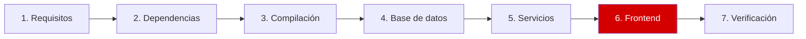
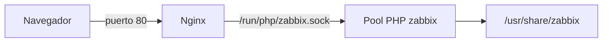

# Paso 6 de 7: Frontend

**Objetivo:** publicar la interfaz web de Zabbix.



## 6.1 Copiar los archivos

```bash
sudo install -d /usr/share/zabbix
sudo cp -a ~/zabbix-8.0.0rc3/ui/. /usr/share/zabbix/
sudo chown -R root:root /usr/share/zabbix
```

## 6.2 Configurar PHP-FPM y Nginx



```bash
cd ~/Zabbix-8-rc3-Instalacion
sudo install -m 644 config/php-fpm-zabbix.conf /etc/php/8.5/fpm/pool.d/zabbix.conf
sudo install -m 644 config/nginx-zabbix.conf /etc/nginx/sites-available/zabbix
sudo ln -sf /etc/nginx/sites-available/zabbix /etc/nginx/sites-enabled/zabbix
sudo rm -f /etc/nginx/sites-enabled/default

sudo php-fpm8.5 -t
sudo nginx -t
sudo systemctl restart php8.5-fpm nginx
```

Ambas pruebas deben terminar en `test is successful`. El pool de PHP usa estos valores:

| Directiva | Mínimo de Zabbix | Configurado |
|---|---|---|
| `memory_limit` | 128M | 256M |
| `post_max_size` | 16M | 16M |
| `upload_max_filesize` | 2M | 2M |
| `max_execution_time` | 300 | 300 |
| `max_input_time` | 300 | 300 |

> [!IMPORTANT]
> El pool también incluye `php_admin_flag[session.upload_progress.enabled] = off`, la mitigación de [CVE-2026-115560](seguridad-php.md). Zabbix no usa esa función.

> [!TIP]
> La zona horaria de PHP es `UTC`, igual que la del sistema. Para usar la tuya, cambia `date.timezone` en el archivo del pool; por ejemplo, `America/La_Paz`.

## 6.3 Conectar el frontend con la base

Este archivo reemplaza al asistente web de instalación:

```bash
PW=$(sudo cat /root/.zabbix/db_password)
sudo sed -E \
  -e "s|^\\\$DB\['TYPE'\].*|\$DB['TYPE'] = 'POSTGRESQL';|" \
  -e "s|^\\\$DB\['PORT'\].*|\$DB['PORT'] = '5432';|" \
  -e "s|^\\\$DB\['PASSWORD'\].*|\$DB['PASSWORD'] = '$PW';|" \
  -e "s|^\\\$ZBX_SERVER_NAME.*|\$ZBX_SERVER_NAME = 'zabbix-01';|" \
  /usr/share/zabbix/conf/zabbix.conf.php.example \
  | sudo install -o root -g www-data -m 640 /dev/stdin /usr/share/zabbix/conf/zabbix.conf.php
```

## 6.4 Entrar

Abre `http://<IP-de-tu-server>/` e inicia sesión:

| Usuario | Contraseña inicial |
|---|---|
| `Admin` | `zabbix` |

> [!CAUTION]
> **Cambia la contraseña de inmediato:** *User settings → Profile → Change password*.

---

⬅️ [Paso 5](05-servicios.md) | ➡️ Siguiente: [Paso 7: Verificación](07-verificacion.md)
