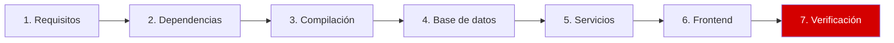
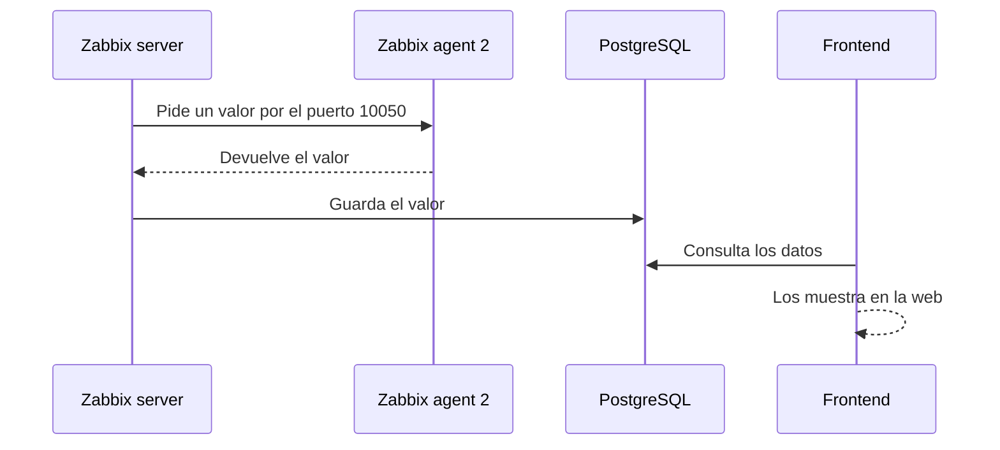

# Paso 7 de 7: Verificación

**Objetivo:** comprobar que todo funciona de punta a punta.



## Cómo viaja un dato



Si un dato no aparece, cada comprobación de abajo te dice en qué tramo buscar.

## Comprobación automática

Funciona igual en ARM64 y AMD64, y no cambia nada en el server:

```bash
cd ~/Zabbix-8-rc3-Instalacion
scripts/verificar.sh
```

Salida en la instalación de referencia (recortada):

```text
✅ Servicio activo: zabbix-server
✅ Arranque automático: zabbix-server
✅ Puerto en escucha: 10051
✅ El agente responde: 8.0.0rc3
✅ La web responde: HTTP 200
✅ La API responde: "result":"8.0.0"

Todo correcto.
```

## Lista de comprobación manual

| # | Qué comprobar | Comando | Resultado esperado |
|---|---|---|---|
| 1 | Servicios activos | `systemctl is-active postgresql nginx php8.5-fpm zabbix-server zabbix-agent2` | Cinco veces `active` |
| 2 | Arranque automático | `systemctl is-enabled postgresql nginx php8.5-fpm zabbix-server zabbix-agent2` | Cinco veces `enabled` |
| 3 | Agente | `zabbix_get -s 127.0.0.1 -k agent.version` | `8.0.0rc3` |
| 4 | Web | `curl -s -o /dev/null -w '%{http_code}\n' http://127.0.0.1/` | `200` |

### Puertos

```bash
ss -tln | grep -E ':(80|5432|10050|10051) '
```

```text
LISTEN 0      4096         0.0.0.0:10051      0.0.0.0:*
LISTEN 0      300        127.0.0.1:5432       0.0.0.0:*
LISTEN 0      511          0.0.0.0:80         0.0.0.0:*
LISTEN 0      4096            [::]:10051         [::]:*
LISTEN 0      4096               *:10050            *:*
LISTEN 0      511             [::]:80            [::]:*
```

### API

```bash
curl -s -H 'Content-Type: application/json-rpc' \
  -d '{"jsonrpc":"2.0","method":"apiinfo.version","params":{},"id":1}' \
  http://127.0.0.1/api_jsonrpc.php
```

```json
{"jsonrpc":"2.0","result":"8.0.0","id":1}
```

> [!NOTE]
> La API responde `8.0.0` aunque la versión es RC3. La versión completa la muestran `zabbix_server -V` y `zabbix_get`.

### En la interfaz web

1. Abre *Monitoring → Hosts*.
2. Busca **Zabbix server**: el indicador **ZBX** debe estar en verde.
3. Abre *Monitoring → Latest data*: deben aparecer valores recientes.

En esta instalación, poco después del arranque, el host figuraba disponible y `system.cpu.num` valía `6`, igual que las vCPU reales.

> [!TIP]
> Los ítems con intervalos largos, como `agent.version` o `system.uname`, pueden tardar en mostrar su primer valor. No es un error.

### Logs

```bash
sudo grep -iE 'cannot|error|fail' /var/log/zabbix/zabbix_server.log
```

Aquí apareció una sola línea, durante el arranque. El agente quedó disponible después, así que no requirió ninguna acción:

```text
Zabbix agent item "system.cpu.util[,iowait]" on host "Zabbix server" failed: first network error, wait for 15 seconds
```

## 🎉 Terminaste

Si todo coincide, Zabbix está listo. Último paso: confirma que cambiaste la contraseña de `Admin`.

---

⬅️ [Paso 6](06-frontend.md) | 🛠️ [Problemas y soluciones](problemas-y-soluciones.md) | 🏠 [Inicio](../README.md)
