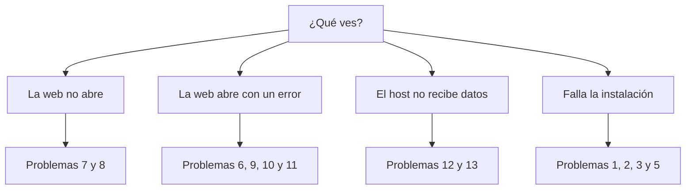
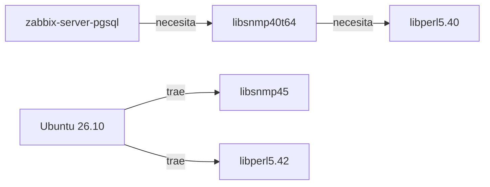
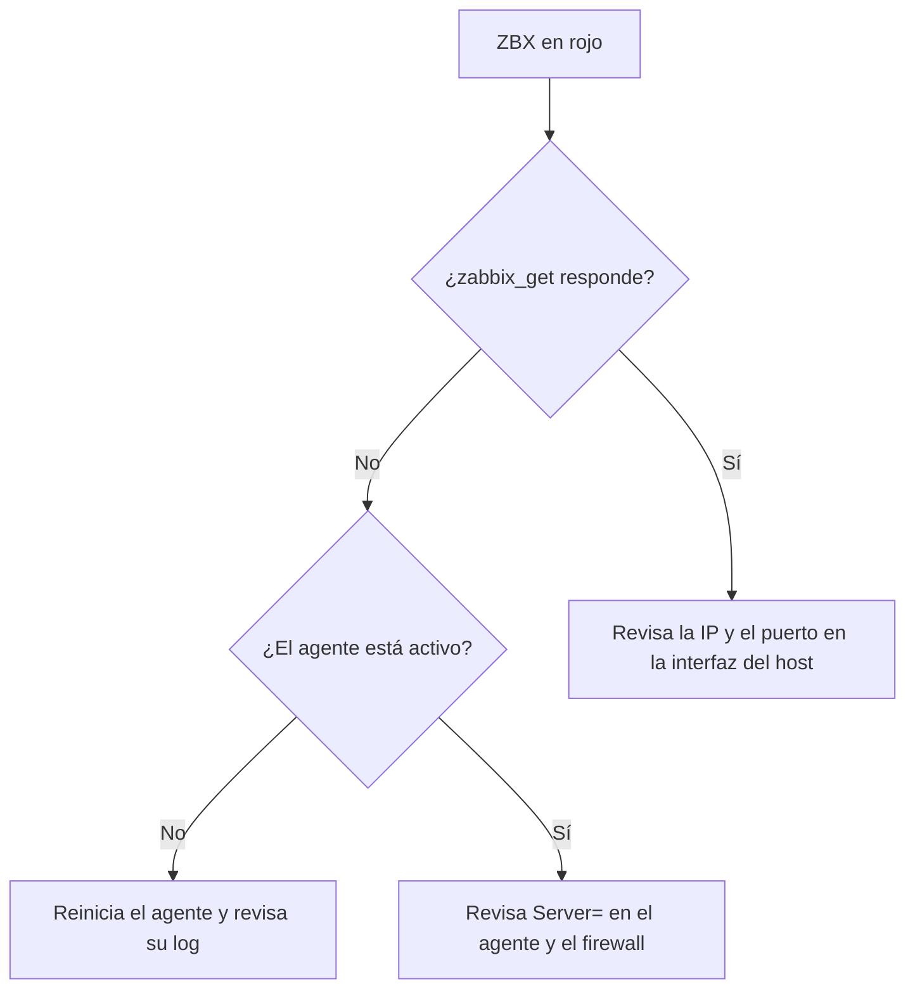

# 🛠️ Problemas y soluciones

## ¿Por dónde empiezo?



**Tres comandos que resuelven la mayoría de los diagnósticos:**

```bash
systemctl status zabbix-server --no-pager
sudo tail -50 /var/log/zabbix/zabbix_server.log
sudo tail -50 /var/log/nginx/error.log
```

| Índice | Problema | Origen |
|---|---|---|
| [1](#1-el-paquete-del-server-no-se-puede-instalar) | El paquete del server no se puede instalar | 🔴 Ocurrió |
| [2](#2-permission-denied-al-importar-el-esquema) | `Permission denied` al importar el esquema | 🔴 Ocurrió |
| [3](#3-un-comando-largo-se-parte-al-pegarlo) | Un comando largo se parte al pegarlo | 🔴 Ocurrió |
| [4](#4-la-api-responde-800-en-lugar-de-rc3) | La API responde `8.0.0` en lugar de RC3 | 🔴 Ocurrió |
| [5](#5-configure-se-detiene-con-un-error) | `configure` se detiene con un error | 🟡 Posible |
| [6](#6-el-server-no-conecta-con-la-base-de-datos) | El server no conecta con la base | 🟡 Posible |
| [7](#7-se-ve-la-página-de-bienvenida-de-nginx) | Se ve la bienvenida de Nginx | 🟡 Posible |
| [8](#8-nginx-no-arranca) | Nginx no arranca | 🟡 Posible |
| [9](#9-error-502-bad-gateway) | Error 502 Bad Gateway | 🟡 Posible |
| [10](#10-la-web-muestra-el-asistente-de-instalación) | La web muestra el asistente | 🟡 Posible |
| [11](#11-zabbix-server-is-not-running) | `Zabbix server is not running` | 🟡 Posible |
| [12](#12-el-indicador-zbx-está-en-rojo) | El indicador ZBX está en rojo | 🟡 Posible |
| [13](#13-fallan-los-chequeos-de-ping) | Fallan los chequeos de ping | 🟡 Posible |
| [14](#14-el-server-se-queda-sin-memoria) | El server se queda sin memoria | 🟡 Posible |

🔴 **Ocurrió:** pasó en esta instalación y la solución se aplicó.
🟡 **Posible:** no pasó aquí. Es una guía de diagnóstico para problemas habituales; los mensajes exactos pueden variar.

---

# 🔴 Problemas que ocurrieron

## 1. El paquete del server no se puede instalar

| | |
|---|---|
| **Síntoma** | `zabbix-server-pgsql` tiene dependencias que no se pueden resolver en Ubuntu 26.10 |
| **Causa** | El repositorio solo llega a Ubuntu 26.04. Su paquete pide `libsnmp40t64`, y 26.10 trae `libsnmp45` |
| **Solución** | Compilar desde el código, como en esta guía |



> [!WARNING]
> No fuerces la instalación mezclando librerías de 26.04: tendrías que arrastrar más paquetes ajenos a tu sistema.

## 2. `Permission denied` al importar el esquema

```text
psql: error: .../database/postgresql/schema.sql: Permission denied
```

| | |
|---|---|
| **Causa** | Con `sudo -u zabbix psql -f archivo`, quien abre el archivo es el usuario `zabbix`, que no tiene acceso a esa carpeta |
| **Efecto** | No se importó nada: la base quedó vacía |
| **Solución** | Pasar el archivo por tubería, para que lo lea tu usuario |

```bash
# ❌ Falla si zabbix no puede leer la carpeta
sudo -u zabbix psql -d zabbix -f schema.sql

# ✅ Funciona
cat schema.sql | sudo -u zabbix psql -q -v ON_ERROR_STOP=1 -d zabbix
```

## 3. Un comando largo se parte al pegarlo

```text
/etc/sudoers.d/<archivo>:1:15: expected host name
```

| | |
|---|---|
| **Causa** | Al copiar desde una ventana estrecha, una línea larga se pegó como dos. Una regla de `sudoers` quedó dividida |
| **Efecto** | `sudo` mostraba errores de sintaxis cada vez que se usaba, y la regla no se aplicaba |
| **Solución** | Dividir el comando en líneas cortas y validar el resultado |

```bash
sudo visudo -c
```

```text
/etc/sudoers: parsed OK
```

> [!TIP]
> Si editas `sudoers`, valida con `sudo visudo -c` antes de cerrar la sesión. En los comandos de esta guía, las líneas terminadas en `\` continúan en la siguiente: pégalas completas.

## 4. La API responde `8.0.0` en lugar de RC3

**No es un fallo.** `apiinfo.version` devuelve `8.0.0`, mientras que los programas muestran la versión completa:

```bash
zabbix_server -V | head -1
```

```text
zabbix_server (Zabbix) 8.0.0rc3
```

---

# 🟡 Otros problemas posibles

## 5. `configure` se detiene con un error

| | |
|---|---|
| **Síntoma** | `configure: error: ...` indicando una librería no encontrada |
| **Causa** | Falta el paquete de desarrollo (`-dev`) de esa librería |
| **Diagnóstico** | Lee la última línea; el detalle está en `config.log` |
| **Solución** | Instala todos los paquetes del [paso 2](02-dependencias.md) y repite `./configure` |

```bash
tail -30 config.log
apt-cache search <nombre-de-la-libreria> | grep dev
```

## 6. El server no conecta con la base de datos

| | |
|---|---|
| **Síntoma** | En el log: `password authentication failed for user "zabbix"` o `connection refused` |
| **Causas** | Contraseña distinta en `zabbix_server.conf` o `zabbix.conf.php`, o PostgreSQL detenido |

```bash
systemctl is-active postgresql
sudo grep -E '^DB(Host|Name|User)=' /etc/zabbix/zabbix_server.conf
```

Si la contraseña no coincide, repite el `sed` de `DBPassword` del [paso 5](05-servicios.md) y reinicia:

```bash
sudo systemctl restart zabbix-server
```

## 7. Se ve la página de bienvenida de Nginx

| | |
|---|---|
| **Causa** | El sitio `default` sigue activo o el de Zabbix no está enlazado |

```bash
ls -l /etc/nginx/sites-enabled/
sudo rm -f /etc/nginx/sites-enabled/default
sudo ln -sf /etc/nginx/sites-available/zabbix /etc/nginx/sites-enabled/zabbix
sudo nginx -t && sudo systemctl reload nginx
```

## 8. Nginx no arranca

| | |
|---|---|
| **Síntoma** | `bind() to 0.0.0.0:80 failed (98: Address already in use)` |
| **Causa** | Otro programa, a menudo Apache, ya usa el puerto 80 |

```bash
sudo ss -tlnp | grep ':80 '
sudo systemctl disable --now apache2   # solo si era Apache y no lo necesitas
sudo systemctl restart nginx
```

## 9. Error 502 Bad Gateway

| | |
|---|---|
| **Causa** | Nginx no llega a PHP-FPM: el servicio está detenido o falta el socket |

```bash
systemctl is-active php8.5-fpm
ls -l /run/php/zabbix.sock
sudo php-fpm8.5 -t
sudo tail -20 /var/log/nginx/error.log
sudo systemctl restart php8.5-fpm
```

## 10. La web muestra el asistente de instalación

| | |
|---|---|
| **Causa** | `zabbix.conf.php` no existe o PHP no puede leerlo |

```bash
sudo ls -l /usr/share/zabbix/conf/zabbix.conf.php
```

Debe mostrar `-rw-r----- root www-data`. Si falta, repite el [paso 6.3](06-frontend.md).

## 11. `Zabbix server is not running`

| | |
|---|---|
| **Síntoma** | Aviso en la web, aunque la página cargue |
| **Causas** | El servicio está detenido, o no terminó de arrancar |

```bash
systemctl status zabbix-server --no-pager
sudo tail -50 /var/log/zabbix/zabbix_server.log
ss -tln | grep ':10051 '
```

Si el log menciona la versión de la base, confirma que el esquema corresponde a este mismo RC3 ([paso 4](04-base-de-datos.md)).

## 12. El indicador ZBX está en rojo



```bash
zabbix_get -s 127.0.0.1 -k agent.version
systemctl status zabbix-agent2 --no-pager
sudo tail -30 /var/log/zabbix/zabbix_agent2.log
sudo grep -E '^(Server|ServerActive|Hostname)=' /etc/zabbix/zabbix_agent2.conf
```

> [!NOTE]
> Justo después del arranque, el indicador puede tardar en ponerse verde. Espera un par de minutos antes de investigar.

## 13. Fallan los chequeos de ping

| | |
|---|---|
| **Causas** | Ruta incorrecta de `fping` o falta del permiso de red |

```bash
which fping
getcap /usr/bin/fping
sudo grep '^FpingLocation=' /etc/zabbix/zabbix_server.conf
```

Debe mostrar `/usr/bin/fping` y `cap_net_raw=ep`. Si falta el permiso:

```bash
sudo setcap cap_net_raw=ep /usr/bin/fping
```

## 14. El server se queda sin memoria

| | |
|---|---|
| **Síntoma** | Lentitud, uso alto de swap, o procesos terminados por el sistema |
| **Causa** | Más carga de la que soporta la RAM disponible |

```bash
free -h
sudo journalctl -k --no-pager | grep -i 'out of memory'
sudo grep -iE 'out of memory|cache' /var/log/zabbix/zabbix_server.log | tail
```

| Si... | Prueba... |
|---|---|
| Se llena la caché de Zabbix | Subir `CacheSize` en `zabbix_server.conf` |
| PostgreSQL usa demasiado | Bajar `shared_buffers` en `conf.d/zabbix.conf` |
| Nada alcanza | Agregar RAM: Zabbix da 8 GiB como ejemplo para 1 000 métricas |

---

## Cómo volver a empezar

> [!CAUTION]
> Esto **borra todos los datos** de Zabbix: configuración e historial.

```bash
sudo systemctl stop zabbix-server
sudo -u postgres dropdb zabbix
sudo -u postgres createdb -O zabbix -E Unicode -T template0 zabbix
```

Después, repite la [importación del paso 4.2](04-base-de-datos.md#42-importar-las-tablas-y-los-datos-iniciales) e inicia el servicio:

```bash
sudo systemctl start zabbix-server
```

---

🏠 [Volver al inicio](../README.md)
