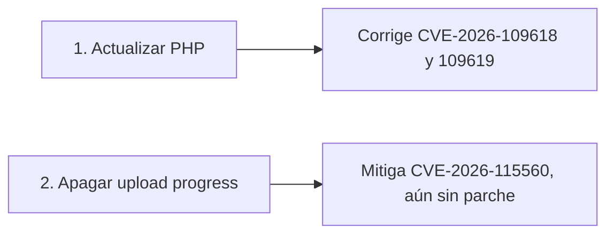
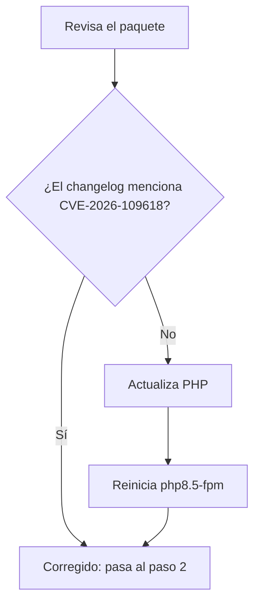

# 🔒 Seguridad de PHP: vulnerabilidades de octubre de 2026

> **Última revisión: 31 de octubre de 2026.** Este tema cambia rápido: confirma el estado en las [fuentes](#fuentes).

## En resumen

El frontend de Zabbix funciona con PHP, así que estas fallas afectan a tu server. Necesitas hacer **dos cosas**:



| CVE | Qué permite | Gravedad | Explotación | Solución |
|---|---|---|---|---|
| **CVE-2026-109618** y **CVE-2026-109619** ("php2shell") | Ejecutar código en el server sin iniciar sesión | Crítica (CVSS v4 9.2) | Activa, en el catálogo KEV de CISA | Actualizar PHP |
| **CVE-2026-115560** | Ejecutar código, con una configuración poco común | Sin puntuación publicada en las fuentes revisadas | Sin reportes en las fuentes revisadas | Sin parche conocido: aplicar la mitigación |

## Versiones corregidas

> [!IMPORTANT]
> **`php -v` puede engañarte.** Ubuntu agrega los parches sin cambiar la versión base: `8.5.9` no llega a 8.5.12, y aun así puede estar corregida. Revisa el paquete.

| Origen de PHP | Versión con parche de 109618 y 109619 |
|---|---|
| **Ubuntu 26.10** (ARM64 y AMD64) | `8.5.9-0ubuntu2.1` |
| **Ubuntu 26.04** (ARM64 y AMD64) | `8.5.4-0ubuntu1.5` |
| **Proyecto PHP** | 8.5.12, 8.4.27, 8.3.36 y 8.2.35 |

> [!WARNING]
> El paquete original de Ubuntu 26.10, `8.5.9-0ubuntu1`, **no** tiene este parche. Viene en `stonking-security` y `stonking-updates`.

## Paso 1: comprueba si tienes el parche



```bash
dpkg-query -W -f='${Version}\n' php8.5-fpm
zcat /usr/share/doc/php8.5-fpm/changelog.Debian.gz | grep -c 'CVE-2026-109618'
```

| Resultado del segundo comando | Significado |
|---|---|
| Mayor que `0` | ✅ Tienes el parche |
| `0` | ❌ Actualiza |

Para actualizar:

```bash
sudo apt-get update
sudo apt-get install --only-upgrade 'php8.5*'
sudo systemctl restart php8.5-fpm
```

## Paso 2: aplica la mitigación de CVE-2026-115560

La recomendación es apagar `session.upload_progress`. **Debe hacerse en el pool de PHP, no desde la aplicación.** El archivo [`php-fpm-zabbix.conf`](../config/php-fpm-zabbix.conf) de esta guía ya la incluye:

```ini
php_admin_flag[session.upload_progress.enabled] = off
```

Si seguiste la guía antes de que se agregara esta línea, instala el archivo actualizado:

```bash
cd ~/Zabbix-8-rc3-Instalacion
git pull
P=/etc/php/8.5/fpm/pool.d/zabbix.conf
sudo install -m 644 config/php-fpm-zabbix.conf "$P"
sudo php-fpm8.5 -t
sudo systemctl restart php8.5-fpm
```

> [!NOTE]
> Usa `restart`, no `reload`, para que todos los procesos de PHP tomen el cambio.

### ¿Esto afecta a Zabbix?

En el código del frontend RC3 no aparecen `session.upload_progress` ni `session.serialize_handler`, por lo que apagar esta función no debería afectarlo. Por el mismo motivo, Zabbix no parece cumplir las condiciones de este CVE, pero se mitiga igual: PHP no ha publicado todos los detalles, y el server podría alojar otras aplicaciones.

## Paso 3: verifica

```bash
scripts/verificar.sh
```

Busca estas dos líneas:

```text
✅ PHP tiene el parche de CVE-2026-109618 y 109619
✅ Mitigación de CVE-2026-115560 en el pool de PHP
```

> [!WARNING]
> `php -i` muestra la configuración de la línea de comandos, no la del pool. Por eso no sirve para confirmar esta mitigación.

## ¿Y si ya estuvo expuesto?

Si tu server corrió PHP sin parche y era accesible desde redes no confiables, revisa estos indicios. Encontrar alguno no prueba un ataque, y no encontrar ninguno no prueba que no lo hubo.

| Revisa | Qué buscar |
|---|---|
| Procesos | `php-fpm` o `www-data` ejecutando `sh`, `bash`, `python`, `perl`, `curl`, `wget` o `nc` |
| Archivos | Archivos `.php` nuevos o modificados en `/usr/share/zabbix` |
| Tareas y cuentas | Cron de `www-data` o cuentas nuevas |
| Logs | Solicitudes extrañas en los logs de Nginx y PHP |

```bash
ps -u www-data -o pid,ppid,lstart,cmd
sudo find /usr/share/zabbix -newermt '2026-10-20' -type f
sudo crontab -u www-data -l
sudo tail -100 /var/log/nginx/access.log
```

> [!NOTE]
> `find` también listará lo que hayas instalado o cambiado desde esa fecha; compáralo con tu instalación.

**Si sospechas un compromiso:**

1. Aísla el server de la red, sin apagarlo si puedes, para no perder evidencia.
2. Guarda una copia de los logs.
3. Reinstala desde cero con PHP corregido, en lugar de limpiar el sistema.
4. Cambia las contraseñas de Zabbix y de la base de datos, y cualquier credencial que Zabbix almacene.

## Reduce el riesgo a futuro

| Medida | Por qué |
|---|---|
| No publicar el frontend directamente en Internet | Las fallas más graves no requieren iniciar sesión |
| Usar VPN o restringir por IP | Reduce quién puede llegar a PHP |
| Activar `unattended-upgrades` | Instala los parches de seguridad de Ubuntu |
| Mantener un pool exclusivo con un usuario sin privilegios | Limita el alcance de una intrusión |
| Vigilar los avisos de PHP y Ubuntu | CVE-2026-115560 sigue abierto |

## Cuando salga el parche de CVE-2026-115560

1. Actualiza PHP como en el paso 1.
2. Confirma que el changelog mencione el CVE: `zcat /usr/share/doc/php8.5-fpm/changelog.Debian.gz | grep -c 'CVE-2026-115560'`
3. Mantén la mitigación si nada en tu server necesita esa función.

## Fuentes

- [PHP: registro de cambios de 8.x](https://www.php.net/ChangeLog-8.php)
- [Ubuntu: changelog de php8.5 para 26.10](https://changelogs.ubuntu.com/changelogs/pool/universe/p/php8.5/php8.5_8.5.9-0ubuntu2.1/changelog)
- [Ubuntu: changelog de php8.5 para 26.04](https://changelogs.ubuntu.com/changelogs/pool/universe/p/php8.5/php8.5_8.5.4-0ubuntu1.5/changelog)
- [Centro Canadiense de Ciberseguridad: alerta AL26-026](https://www.cyber.gc.ca/en/alerts-advisories/al26-026-critical-vulnerabilities-impacting-php-cve-2026-109618-cve-2026-109619)
- [CISA: alerta sobre las vulnerabilidades de PHP](https://www.cisa.gov/news-events/alerts/2026/10/21/critical-vulnerabilities-php-require-immediate-patching)
- [Huntress: análisis de php2shell](https://www.huntress.com/blog/php2shell-leaked-critical-php-vulnerabilities)
- [Astra Security: CVE-2026-115560](https://www.getastra.com/blog/security-advisory/cve-2026-115560/)

---

🛠️ [Problemas y soluciones](problemas-y-soluciones.md) | 🏠 [Inicio](../README.md)
